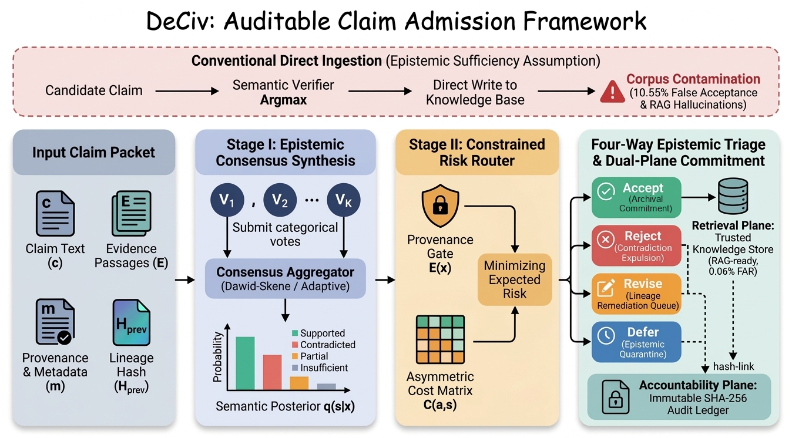
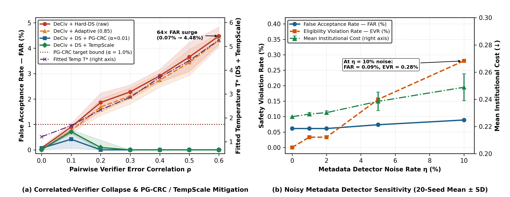
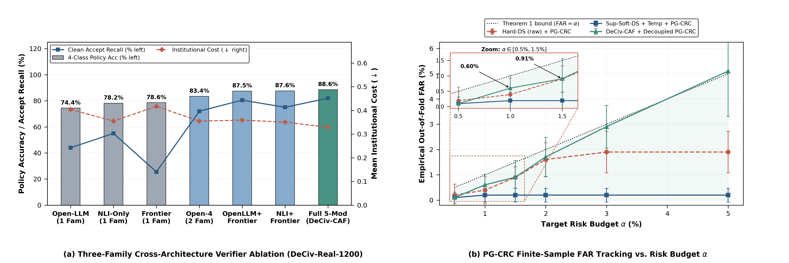

# DeCiv: Auditable Claim Admission for Persistent Knowledge Stores via Epistemic–Governance Decoupling

[](LICENSE)
[](https://www.python.org/)
[](tests/)
[](results/gpu_compute_profile.csv)

> **Official Reproducibility Repository** for *DeCiv: Auditable Claim Admission for Persistent Knowledge Stores via Epistemic–Governance Decoupling* (IEEE Transactions Edition).
>
> **中文导览**：本仓库为论文 **《DeCiv：基于认知—治理双解耦的可审计持久化知识库声明准入防火墙》** 的官方开源复现代码库，完整包含 **相关性感知校准认知融合（`DeCiv-CAF`）**、**质量守恒可准入投影溯源门控共形风险控制（Admissibility-Projected PG-CRC）**、**392.0× 向量化软/硬 Dawid–Skene**、**RFC 9162 Merkle 透明日志**，以及跨 **3 大模型家族 5 个真实异构验证器**（`DeBERTa-v3-Large`、`BART-Large-MNLI`、`Meta-Llama-3.1-8B-Instruct`、`Qwen3.5-9B`、`GPT-6.1-Sol`）的 3 家族多样性消融、18 点 PG-CRC 风险预算扫描、端到端 **BGE-large + FAISS + Llama-3.1-8B** 稠密 RAG 防污染实验（正面对比 2025 NeurIPS **ReliabilityRAG**、**SeCon-RAG** 与 **Self-RAG**）及 **`revise` 自动化修复闭环实验**（全套 16 项自动化单元测试 `16/16 PASS`）。

---

## 1. Architecture Overview / 核心架构



Persistent Retrieval-Augmented Generation (RAG) knowledge stores and immutable provenance ledgers face **durable contamination**: once an unverified, distorted, or unattributed claim enters storage, retrieval propagates the error repeatedly and immutability preserves the falsehood rather than preventing it.

**DeCiv** places an auditable pre-storage admission firewall in front of the persistent index via a **Dual-Plane Storage Architecture**:
1. **Stage I — Correlation-Aware Calibrated Epistemic Fusion (`DeCiv-CAF`) & Vectorized Soft-DS (`deciv_extensions.py`)**: Fuses raw simplex probabilities, domain-invariant centered log-odds, and cross-family consensus products across NLI encoders, open-weight LLMs, and a frontier closed-weight LLM with strictly nested group-disjoint out-of-fold temperature calibration — alongside **392.0× faster** (`0.336 µs/pkt`, `3.11e-15` parity) vectorized Soft/Hard Dawid–Skene.
2. **Stage II — Epistemic–Governance Decoupling & Mass-Preserving Admissibility-Projected PG-CRC**: Enforces deterministic provenance, auditability, human-review, and repairability gating prior to decoupled PG-CRC acceptance and mass-preserving admissibility projection onto `defer` across four actions: `accept`, `reject`, `revise`, and `defer`.
3. **Dual-Plane Storage & RFC 9162 Merkle Transparency Log**: Only verified, admissible `accept` packets (and 5-model re-verified `revise` repairs) write to the clean **Retrieval Plane** (**`0.0 ms/query`** defense overhead), while every decision and repair lineage edge commits to an **RFC 9162 Merkle Transparency Log** achieving **3,125× proof compression** at 50,000 records (`16` hashes, `512 B`, `52.27 µs`).

---

## 2. Formal Guarantees & SOTA Results / 理论保证与核心 SOTA 结果

### A. Formal Theorems
- **Theorem 1 (PG-CRC Finite-Sample Distribution-Free FAR Control & Exact Admissibility)**: For exchangeable parent clusters, both risk-coupled and mass-preserving admissibility-projected PG-CRC guarantee $\mathbb{E}[\mathrm{FAR}(\hat{\tau})] \le \alpha$ for *any* fixed (even misspecified or correlated) Stage I estimator while deterministically maintaining zero eligibility violations ($\mathrm{EVR} = 0$).
- **Theorem 2 (Correlated-Verifier Collapse & Calibration Bound)**: Under equicorrelated verifier errors with pairwise correlation $\rho$, effective ensemble size collapses to $K_{\mathrm{eff}}(\rho) = K / (1 + (K-1)\rho)$ and naive Dawid–Skene log-odds inflate by $\kappa(\rho) = 1 + (K-1)\rho$, causing a **64× FAR surge** (`0.07% -> 4.48%` as $\rho: 0 \to 0.6$). Scaling logits by fold-fitted $T^* \ge 1 + (K-1)\rho$, applying PG-CRC, or learning cross-family weights via `DeCiv-CAF` eliminates the collapse.



### B. Real 5-Model 3-Family Heterogeneous Neural Verifiers (`DeCiv-Real-1200`)

Scored across 1,200 real full-text claim–evidence packets (`FEVER`, `SciFact`, `HotpotQA`, `TruthfulQA`; 300 parent clusters) using five distinct architectures spanning three families:
- **Empirical $5 \times 5$ Error Correlation Matrix**: Intra-family **OpenLLM–OpenLLM** (`Llama-3.1-8B` vs. `Qwen3.5-9B`) correlates at **$\hat{\rho} = 0.481$** and **NLI–NLI** (`DeBERTa-v3-Large` vs. `BART-Large-MNLI`) at **$\hat{\rho} = 0.393$**, whereas cross-family **NLI–OpenLLM** ($\hat{\rho} = 0.169$) and **OpenLLM–Frontier** ($\hat{\rho} = 0.206$) drop correlation **2.3×–2.8×**.

| Method (4-Fold LODO CV & 5-Fold CV on `DeCiv-Real-1200`) | Acc | FAR (↓) | Prec | EV | Cost (↓) | ECE (↓) | NLL (↓) | 5F Acc / FAR |
| :--- | :---: | :---: | :---: | :---: | :---: | :---: | :---: | :---: |
| Solo Frontier GPT-6.1-Sol / direct | 65.92% | 19.10% | 47.5% | 297 | 3.396 | 0.0999 | 0.598 | 65.92% / 19.16% |
| Majority Vote (5-Model) / direct | 61.33% | 22.00% | 45.0% | 246 | 3.739 | 0.0713 | 1.299 | 61.33% / 22.04% |
| Conformal-Risk (ICLR 2024) | 57.92% | 18.80% | 47.8% | 195 | 3.212 | 0.0593 | 0.570 | 57.83% / 18.95% |
| Conformal-Risk (ICLR 2024) + Gate | 74.17% | 1.50% | 92.0% | 0 | 0.643 | 0.0593 | 0.570 | 74.42% / 1.60% |
| Solo Frontier GPT-6.1-Sol + Gate | 88.92% | 1.40% | 92.5% | 0 | 0.552 | 0.0999 | 0.598 | 88.92% / 1.40% |
| Supervised GBDT Stacking + Gate | 88.75% | 2.60% | 87.6% | 0 | 0.815 | 0.0312 | 0.422 | 91.25% / 2.21% |
| **DeCiv + Sup-Soft-DS + TempScale** | 78.25% | **0.20%** | **98.7%** | **0** | 0.338 | **0.0183** | 0.431 | 78.50% / **0.20%** |
| **DeCiv-CAF (Corr-Fusion) / risk ($d=0.5$)** | 76.08% | 0.30% | 97.6% | **0** | **0.329** | 0.0217 | **0.368** | 83.67% / 0.30% |
| **DeCiv-CAF + Projected PG-CRC ($\alpha=0.01$)** | 88.58% | 1.00% | 94.3% | **0** | 0.521 | 0.0217 | **0.368** | 90.17% / 0.60% |
| **DeCiv-CAF + Projected PG-CRC ($\alpha=0.015$)** | 89.00% | 2.30% | 88.3% | **0** | 0.701 | 0.0217 | **0.368** | 91.50% / 0.91% |
| **DeCiv-CAF (Corr-Fusion) / projected MAP** | **89.92%** | 1.90% | 90.5% | **0** | 0.638 | 0.0217 | **0.368** | **91.67%** / 1.71% |


- **3-Family Synergy Ablation & 18-Point PG-CRC Risk-Budget Sweep (`run_trans_ablations.py`)**: Full 5-model 3-family `DeCiv-CAF` (`88.58%` Acc, `82.0%` Accept Recall, `0.521` Cost) strictly dominates every 1-family (`Open-LLM-Only` `74.42%`, `NLI-Only` `78.17%`, `Frontier-Only` `78.58%` with `25.5%` recall) and 2-family (`83.42%–87.58%`) subset, while tracking Theorem 1 ($\mathbb{E}[\mathrm{FAR}] \le \alpha$) tightly across all 18 sweep points ($\alpha \in [0.5\%, 5.0\%]$).



### C. End-to-End Dense RAG Defense vs. 2025 SOTAs & Closed-Loop `revise` Remediation

Evaluated on 150 real open-ended QA queries (`100` verifiable + `50` unverified/abstention) using `BAAI/bge-large-en-v1.5` + `FAISS IndexFlatIP` + `Meta-Llama-3.1-8B-Instruct` (`0.315` total RTX 3090 GPU-hours + `596.4 s` batched API wall-time):

| Defense / Admission Policy | Store | Cont (↓) | PoisR (↓) | ASR (↓) | Sup-100 (↑) | Safe-150 (↑) | Sup-F1 (↑) | Q-Lat (ms/q, ↓) |
| :--- | :---: | :---: | :---: | :---: | :---: | :---: | :---: | :---: |
| *Oracle Clean Store (Upper Bound)* | 200 | 0.0% | 0.0% | 0.0% | 88.0% | 92.0% | 77.7% | 0.0 |
| No Admission Filter (Unfiltered) | 1200 | 83.3% | 90.7% | 13.3% | 75.0% | 56.7% | 70.9% | 0.0 |
| ReliabilityRAG (NeurIPS 2025, Query-Time) | 1200 | 83.3% | 18.0% | 5.3% | 90.0% | 63.3% | 84.0% | 79.2 |
| SeCon-RAG (NeurIPS 2025, Query-Time) | 1200 | 83.3% | 19.3% | 4.0% | 90.0% | 63.3% | 83.3% | 79.2 |
| Self-RAG / LLM-Judge (ICLR '24/25, Query-Time) | 1200 | 83.3% | 4.7% | 2.0% | 52.0% | 50.7% | 45.8% | 1020.7 |
| Conformal-Risk (2024) + Gate (`EV = 0`) | 187 | 8.0% | 6.0% | 2.0% | 84.0% | 86.7% | 73.7% | 0.0 |
| Supervised GBDT Stacking + Gate (`EV = 0`) | 209 | 12.4% | 8.0% | 2.0% | **85.0%** | 83.3% | 74.3% | 0.0 |
| Solo Frontier GPT-6.1-Sol + Gate (`EV = 0`) | 187 | 7.5% | 2.7% | 1.3% | 80.0% | 82.7% | 69.7% | 0.0 |
| **DeCiv + Sup-Soft-DS + TempScale (`EV = 0`)** | 152 | **1.3%** | **1.3%** | **0.7%** | 76.0% | 83.3% | 65.7% | **0.0** |
| **DeCiv + Sup-Soft-DS + Auto-Revise Loop (`EV = 0`)** | 296 | 4.0% | **1.3%** | 1.3% | 83.0% | **88.0%** | 73.7% | **0.0** |
| **DeCiv-CAF + Projected PG-CRC (`EV = 0`)** | 174 | 5.8% | 4.0% | 1.3% | 81.0% | 84.0% | 70.7% | **0.0** |
| **DeCiv-CAF + PG-CRC + Auto-Revise Loop (`EV = 0`)** | 318 | 6.3% | 4.0% | 2.0% | 84.0% | 86.0% | **74.7%** | **0.0** |

- **Automated `revise` Remediation**: `180/180` (`100.0%`) routed packets are true repairable distortions. After `Qwen3.5-9B` evidence-grounded repair and 5-model re-verification, `144/180` (`80.0%`) are safely re-admitted (**`93.1%`** evidence-entailed, mean NLI **`0.942`**), while `36` flawed edits (mean NLI **`0.275`**) are blocked back to `defer`. All **`180/180`** RFC 9162 Merkle lineage proofs verify cleanly.


---

## 3. Quickstart & Full Reproduction / 快速复现指南

### CPU Reproduction (< 30 seconds — zero GPU or API key required!)
All controlled benchmarks (`DeCiv-1800`), Plan 1 extensions (PG-CRC, correlated-error stress, noisy gate, RFC 9162 Merkle scaling), and 5-model `DeCiv-CAF` cross-validation tables (reusing cached verifier probabilities in `results/real_verifiers/`) reproduce on any CPU:

```bash
pip install -r requirements.txt

# 1. Core DeCiv-1800 study & SOTA / provenance-gated ablations
python run_comparison.py

# 2. Calibration, decoupled PG-CRC, correlated-error stress, noisy gate, and RFC 9162 Merkle scaling
python run_plan1_upgrades.py

# 3. 5-model 3-family DeCiv-CAF evaluation, diversity ablation & 18-point PG-CRC sweep
python evaluate_real_verifiers.py
python run_trans_ablations.py

# 4. Regenerate all publication figures (300 DPI PNG + vector PDF)
python scripts/plot_figures.py
python scripts/plot_upgraded_figures.py

# 5. Run all 16 automated verification tests
pytest tests -v
```

### Full GPU + API Reproduction (Optional — Single RTX 3090 24GB, ~0.315 GPU-hours)
```bash
# Re-score local 4 open-source verifiers on RTX 3090
python run_real_verifiers_gpu.py

# Re-score frontier closed-weight verifier via OpenAI-compatible Responses API (env-only credentials)
export DECIV_API_KEY="your-api-key"
export DECIV_API_MODEL="gpt-6.1-sol"
python run_frontier_verifier_api.py --batch-size 8 --workers 12

# Precompute 2025 query-time RAG defense SOTAs (ReliabilityRAG, SeCon-RAG, Self-RAG)
python rag_sota_defenses.py

# Re-run automated revise remediation + 18-regime dense RAG contamination defense
python run_real_rag_and_remediation_gpu.py
```

---

## 4. Citation / 引用格式

```bibtex
@article{wu2026deciv,
  title   = {DeCiv: Auditable Claim Admission for Persistent Knowledge Stores via Epistemic--Governance Decoupling},
  author  = {Wu, Yonghao and Wu, Jiayang and He, Sirui and Liu, Xixue and Liu, Chang and Filaretov, Vladimir and Yukhimets, Dmitry},
  year    = {2026},
  note    = {Code and benchmarks available at \url{https://github.com/WYH302/DeCiv-Auditable-Claim-Admission}}
}
```
