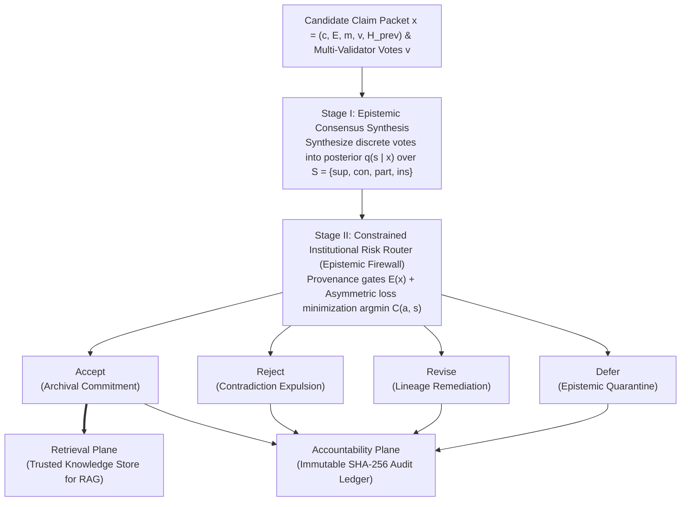
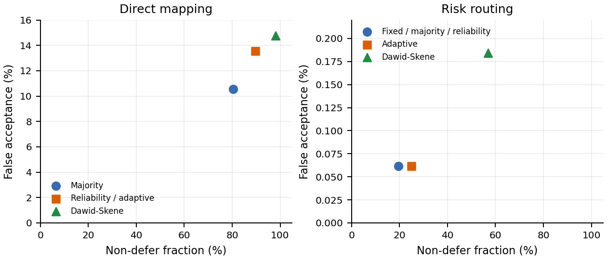
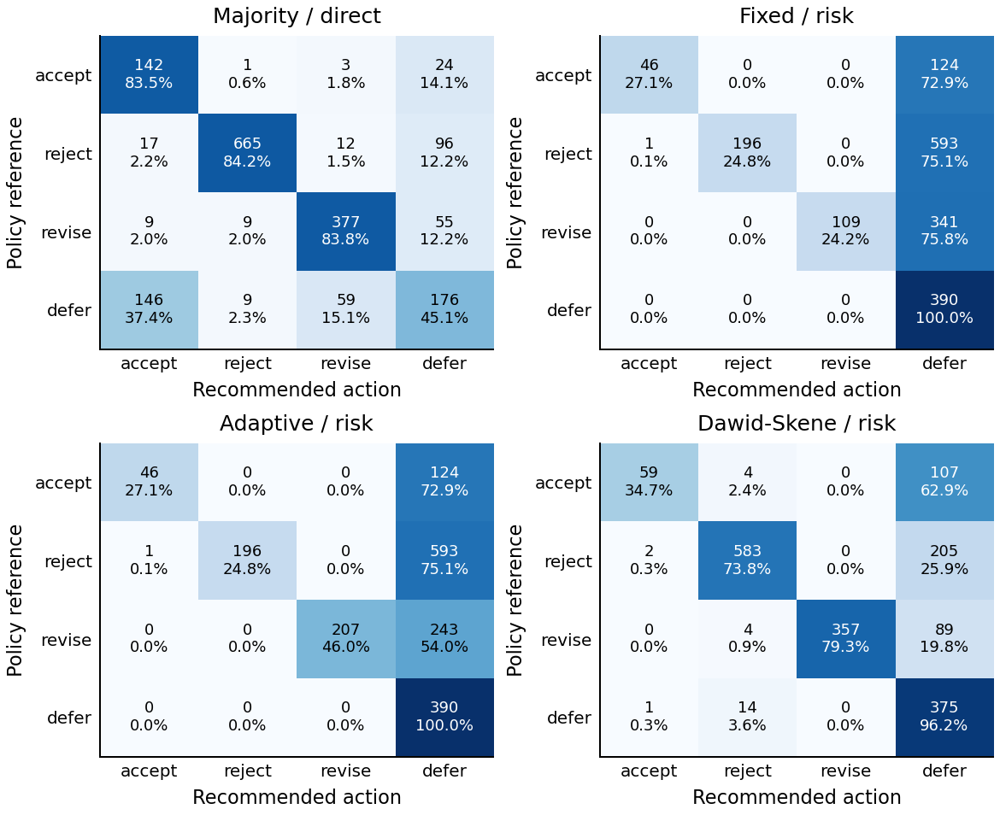
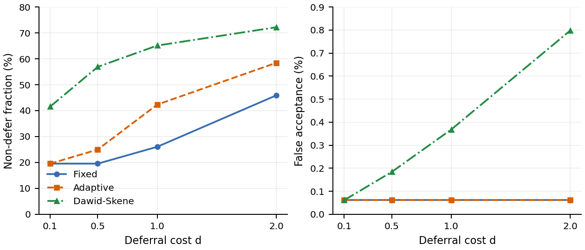

# DeCiv: Auditable Claim Admission for Persistent Knowledge Stores

[](https://www.python.org/)
[](LICENSE)
[](#dataset--benchmark-composition)
[](#main-empirical-results-rq1)
[](#dual-plane-memory-commitment)

Official open-source implementation, benchmark dataset, and reproducibility suite for **DeCiv** (*Auditable Claim Admission for Persistent Knowledge Stores: A Four-Action Risk-Aware Framework*).

---

## Overview: Bridging the Epistemic–Institutional Gap

Persistent knowledge repositories (enterprise knowledge graphs, digital archives, and retrieval-augmented generation [RAG] vector stores) confront a fundamental **Epistemic–Institutional Gap**: determining whether a candidate assertion is *semantically supported by evidence* (**epistemic validity**) is structurally distinct from determining whether it satisfies the *provenance, locator verifiability, and repairability standards* required for durable institutional storage (**institutional admissibility**).

Conventional verification pipelines operate under an implicit *epistemic sufficiency assumption*—treating high semantic confidence as direct authorization for database ingestion—or rely on binary abstention that collapses outright refutation, repairable localized flaws, and missing provenance into an undifferentiated backlog.

**DeCiv** resolves this dilemma through three core architectural innovations:

1. **Epistemic–Governance Decoupling (EGD)**: Separates **Stage I (Epistemic Consensus Synthesis)**—which aggregates noisy multi-validator votes into posterior distributions $q(s \mid x)$ over four semantic states ($\mathcal{S} = \{\text{sup}, \text{con}, \text{part}, \text{ins}\}$)—from **Stage II (Constrained Institutional Risk Routing)**, an epistemic firewall that enforces metadata eligibility gates $\mathcal{E}(x)$ and asymmetric expected-cost minimization $C(a, s)$.
2. **Four-Way Epistemic Triage**: Replaces binary accept/abstain decisions with four distinct institutional lifecycle dispositions:
   - **`accept` (Archival Commitment)**: Verified claims with intact, resolvable provenance are indexed into the trusted knowledge store.
   - **`reject` (Contradiction Expulsion)**: Factual contradictions are permanently withheld and logged to prevent redundant resubmission.
   - **`revise` (Lineage-Tracked Remediation)**: Substantively grounded claims with localized numerical/temporal flaws and documented repair paths are routed to editorial remediation with cryptographic version linkage $(v+1, H_{\text{prev}} = H(r_v))$.
   - **`defer` (Epistemic Quarantine)**: Ambiguous assertions or supported claims lacking verifiable provenance are isolated in an investigation queue.
3. **Dual-Plane Memory Commitment**: Splits persistence into two orthogonal planes:
   - **Retrieval Plane (Trusted Knowledge Store)**: Admits exclusively `accept` claims ($m_{\text{prov}}=1, m_{\text{ver}}=1$) to immunize downstream RAG pipelines against hallucination propagation and recursive model collapse.
   - **Accountability Plane (Immutable Audit Ledger)**: Commits all four dispositions ($a^* \in \mathcal{A}$) as SHA-256 content-hashed audit records $r = (H(x), a^*, q(\cdot \mid x), \mathcal{E}(x), \tau, H_{\text{prev}})$.



---

## Key Empirical Findings

### 1. Selectivity–Throughput Trade-Off (`RQ1`)



| Estimator / Router | Four-Action Acc. (%) | False Acceptance Rate (FAR, %) | Accept Precision (%) | Acceptance Rate (%) | Non-Defer Fraction (%) | Eligibility Violations |
| :--- | :---: | :---: | :---: | :---: | :---: | :---: |
| **Majority / direct** | 75.56 | 10.55 | 45.22 | 17.44 | 80.50 | 221 |
| **Reliability-weighted / direct** | 77.06 | 13.56 | 40.75 | 20.72 | 89.72 | 265 |
| **Dawid–Skene / direct** | 71.78 | 14.79 | 36.07 | 20.94 | 98.17 | 330 |
| **DeCiv Fixed / direct** | 75.56 | 10.55 | 45.22 | 17.44 | 80.50 | 221 |
| **DeCiv Adaptive / direct** | 77.06 | 13.56 | 40.75 | 20.72 | 89.72 | 265 |
| **Majority / risk** | 41.17 | **0.06** | **97.87** | 2.61 | 19.56 | **0** |
| **Reliability-weighted / risk** | 41.17 | **0.06** | **97.87** | 2.61 | 19.56 | **0** |
| **Dawid–Skene / risk** | **76.33** | **0.18** | **95.16** | 3.44 | **56.89** | **0** |
| **DeCiv Fixed / risk** | 41.17 | **0.06** | **97.87** | 2.61 | 19.56 | **0** |
| **DeCiv Adaptive / risk** | **46.61** | **0.06** | **97.87** | 2.61 | **25.00** | **0** |

- **Eliminating Unvetted Ingestion**: Direct majority mapping achieves 75.56% accuracy but suffers a **10.55% false-acceptance rate (FAR)** (172 false accepts out of 1,630 policy-nonacceptable packets; 45.22% accept precision) because semantic aggregators ignore broken or missing provenance.
- **Zero-Contamination Boundary**: Contextual risk routing eliminates all provenance eligibility violations (`0 / 1,800`) and suppresses FAR by $-10.49$ percentage points (95% cluster-bootstrap CI: $[-11.77\%, -9.27\%]$) down to **0.06%** (97.87% accept precision).
- **Consensus-Amplified Adaptive Recovery**: Agreement-adjusted adaptive weighting dynamically amplifies high-concordance packets, expanding non-deferral from 19.56% to **25.00%** and accuracy from 41.17% to **46.61%** ($+5.44$ pp, 95% CI: $[4.50\%, 6.39\%]$) by nearly doubling revision recall (`24.22% -> 46.00%`) at **zero additional false acceptance (0.06% FAR)**.
- **Latent-Class Calibration**: Dawid–Skene EM estimation paired with risk routing reaches **76.33% accuracy** and **56.89% non-deferral** while holding FAR to **0.18%** (95.16% accept precision).

---

### 2. Four-Way Epistemic Triage Confusion Structure (`RQ2`)



- On **Reference Defer ($N=390$)** packets (including 170 semantically supported claims with broken/missing provenance), direct majority voting falsely admits **146 packets (37.4%)** into trusted storage. Both Fixed and Adaptive risk routers achieve **100.0% quarantine recall (`390 / 390`)**, and Dawid–Skene risk routing quarantines **375 packets (96.2%)** with only 1 false accept (0.3%).
- On **Reference Revise ($N=450$)** packets, Consensus-Amplified Adaptive Risk Routing recovers **207 repairable claims (46.0%)** (up from 109 [24.2%] under Fixed risk routing), and Dawid–Skene risk routing recovers **357 claims (79.3%)**, all with **0 false accepts**.

---

### 3. Cross-Domain Generalization & Deferral-Cost Sensitivity (`RQ3`)



Across four-fold source-held-out cross-validation (training on 3 benchmark sources and testing on the held-out 4th source) and deferral-cost sweeps $d \in \{0.1, 0.5, 1.0, 2.0\}$:
- **Out-of-Domain Safety**: Contextual risk routing achieves **0.00% FAR** on held-out HotpotQA ($N=320$) and Wikipedia Revisions ($N=120$) across all risk routers, **0.00% FAR** on TruthfulQA ($N=320$) under Fixed and Adaptive risk routing (0.31% under Dawid–Skene), and **0.11%–0.21% FAR** on FEVER ($N=1,040$).
- **Parametric Queue Control**: Increasing the deferral penalty $d$ from $0.1$ to $2.0$ smoothly expands non-deferral throughput (`19.56% -> 58.44%` for Adaptive; `41.56% -> 72.17%` for Dawid–Skene) while keeping Fixed and Adaptive FAR invariant at **0.06%**.

---

## Dataset & Benchmark Composition

The benchmark comprises **1,800 structured claim packets** derived from **450 parent claims** across four parent corpora (each parent claim instantiated across intact, provenance-dropout, repairable-corruption, and contradictory-corruption variants):

| Source Stratum | Parent Claims | Total Packets | Policy `accept` | Policy `reject` | Policy `revise` | Policy `defer` |
| :--- | :---: | :---: | :---: | :---: | :---: | :---: |
| **FEVER** | 260 | 1,040 | 90 | 440 | 260 | 250 |
| **TruthfulQA** | 80 | 320 | 0 | 240 | 80 | 0 |
| **HotpotQA** | 80 | 320 | 80 | 80 | 80 | 80 |
| **Wikipedia Revisions** | 30 | 120 | 0 | 30 | 30 | 60 |
| **Total** | **450** | **1,800** | **170** | **790** | **450** | **390** |

---

## Quick Start

### 1. Installation

Requires **Python 3.11+** and `numpy` (plus `matplotlib` for regenerating plots):

```bash
pip install -r requirements.txt
```

### 2. Run the Interactive Demo (`demo.py`)

Inspect the paired execution trace (`FEV2_0001_clean` vs. `FEV2_0001_prov_drop`), SHA-256 audit record commitment, and full 10-configuration benchmark summary:

```bash
python demo.py
```

### 3. Reproduce All 18,000 Predictions & Bootstrap Intervals (`run_comparison.py`)

Execute the complete four-fold source-held-out evaluation, Dawid–Skene EM fitting, 2,000 paired parent-cluster bootstrap resamples, and deferral-cost sensitivity sweep:

```bash
python run_comparison.py
```

### 4. Regenerate Figures & Run Automated Tests

```bash
python scripts/plot_figures.py
python -m unittest discover -s tests -v
```

---

## Repository Structure

```text
├── demo.py                          # Quick-start walkthrough of paired trace & benchmark metrics
├── run_comparison.py                # Full 4-fold cross-validation & 2,000-bootstrap evaluation runner
├── experiment_spec.json             # Prespecified experimental protocol, cost matrix & seed (20261025)
├── requirements.txt                 # Python dependencies (numpy, matplotlib)
├── THIRD_PARTY_NOTICES.md           # Upstream dataset citations and open licenses (FEVER, TruthfulQA, HotpotQA)
├── data/
│   ├── evaluation_index_v2.csv      # Packet-to-parent and source stratum index (1,800 packets)
│   ├── semantic_votes_v2.csv        # 7,200 categorical validator votes (K=4 verifiers)
│   ├── semantic_targets_v2.csv      # Underlying semantic states (sup, con, part, ins)
│   ├── governance_contexts_v2.csv   # Provenance, locator verifiability & repairability flags
│   ├── governance_targets_v2.csv    # Policy-reference admission actions (accept, reject, revise, defer)
│   ├── example_packets.csv          # Worked paired FEVER packets with claim/evidence text & URLs
│   ├── controlled_semantic_profiles_r12.json
│   └── governance_policies_r12.json
├── vendor/deciv2/r12/               # Core DeCiv library
│   ├── contracts.py                 # Packet contracts, governance gates & SHA-256 audit records
│   ├── semantic.py                  # Stage I consensus aggregators & Dawid-Skene EM implementation
│   └── governance.py                # Stage II constrained expected-cost risk router
├── results/
│   ├── main_metrics.csv             # Aggregate metrics across all 10 estimator-router combinations
│   ├── action_confusion.csv         # 4x4 confusion matrices across all configurations
│   ├── by_source.csv                # Source-held-out cross-validation metrics by dataset stratum
│   ├── cost_sensitivity.csv         # Deferral cost sweep (d in {0.1, 0.5, 1.0, 2.0})
│   ├── paired_differences.csv       # 2,000 parent-cluster bootstrap 95% confidence intervals
│   ├── execution_trace.json         # Paired execution trace with SHA-256 audit hashes
│   ├── predictions.csv              # All 18,000 packet-level predictions
│   └── study_report.json            # Complete fold-fit diagnostics and convergence logs
├── figures/                         # Publication-grade figures (PNG & PDF)
│   ├── admission_tradeoff.png
│   ├── routing_confusions.png
│   └── routing_cost_sensitivity.png
├── scripts/
│   └── plot_figures.py              # Standalone figure generator from results/*.csv
└── tests/
    └── test_deciv_reproducibility.py # Automated unit & reproducibility test suite
```

---

## License

This project is released under the [MIT License](LICENSE). See [THIRD_PARTY_NOTICES.md](THIRD_PARTY_NOTICES.md) for upstream benchmark attributions and license terms.
