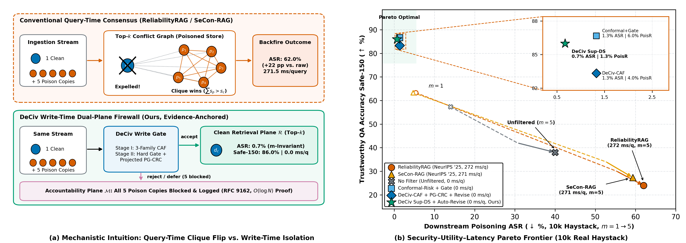
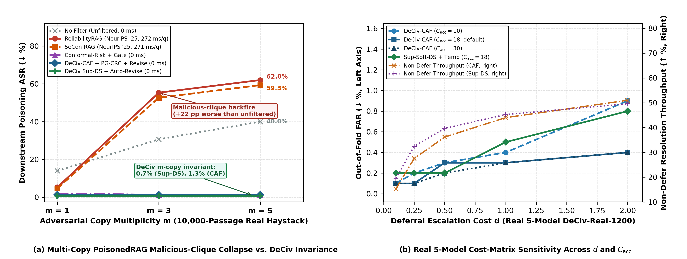

# DeCiv: Auditable Claim Admission for Persistent Knowledge Stores via Epistemic–Governance Decoupling

[](LICENSE)
[](https://www.python.org/)
[](tests/)
[](results/gpu_compute_profile.csv)

> **Official Reproducibility Repository** for *DeCiv: Auditable Claim Admission for Persistent Knowledge Stores via Epistemic–Governance Decoupling*.
>
> **中文导览**：本仓库为论文 **《DeCiv：基于认知—治理双解耦的可审计持久化知识库声明准入防火墙》** 的开源复现代码与基准数据集。我们分享全部代码、缓存模型输出、实测结果与单元测试，力求透明、可复现，同时也深知系统仍有诸多值得完善之处，**诚挚欢迎各位同行与读者批评指正、提出宝贵意见（Issues / PRs 皆非常欢迎）**。

---

## 1. Overview & Architecture / 项目简介与整体架构

Persistent Retrieval-Augmented Generation (RAG) knowledge stores and archival provenance ledgers face a subtle structural hazard: once an unverified, distorted, or unattributed claim enters storage, repeated retrieval amplifies the error across future queries, while cryptographic immutability preserves a falsehood with the same fidelity as a verified fact.

持久化检索增强生成（RAG）知识库与防篡改溯源日志共同面临一个基础矛盾：一旦未经核验、局部失真或缺少溯源依据的声明进入向量底库，后续检索会反复放大错误；而单纯依靠哈希链或区块链的“不可篡改性”只会忠实封存错误记录，并不能阻止污染入库。




**DeCiv** places an auditable admission firewall ahead of persistent storage by separating two concerns that are commonly coupled:
- **Dual-Plane Storage Isolation / 双平面存储隔离**：Only verified, admissible claims (and five-model re-verified `revise` repairs) write to the clean **Retrieval Plane** $\mathcal{R}$ (`0.0 ms/query` defense overhead), while every admission decision and repair lineage edge commits to an append-only **RFC 9162 Merkle Accountability Plane** $\mathcal{M}$ (`16` SHA-256 hashes, `512 B`, `52.27 µs/proof` at $N=50{,}000$).
- **Epistemic–Governance Decoupling / 认知与治理双解耦**：
  - **Stage I (`DeCiv-CAF` & Vectorized Soft-DS)** estimates calibrated four-state epistemic posteriors solely from claim–evidence pairs $(c_i, e_i)$ across three heterogeneous verifier families (`DeBERTa-v3-Large`, `BART-Large-MNLI`, `Meta-Llama-3.1-8B-Instruct`, `Qwen3.5-9B`, and frontier `GPT-6.1-Sol`) using nested group-disjoint out-of-fold temperature scaling.
  - **Stage II (Hard Governance Gate + Admissibility-Projected PG-CRC)** enforces deterministic provenance, auditability, human-review, and repairability rules (`EV = 0`), then routes packets across `accept`, `reject`, `revise`, and `defer` with finite-sample cluster-FAR guarantees while projecting blocked action mass onto `defer`.

---

## 2. Research Notes: Thinking Process, Pitfalls & Observations / 真实思考过程、踩过的坑与独特观察

Rather than presenting only polished tables, we briefly document four concrete pitfalls we ran into while building DeCiv and the observations that reshaped our design.

相比只展示最终漂亮的数据表格，我们更希望坦诚记录研究过程中踩过的四个真实大坑，以及由此得出的观察，供社区参考与讨论：

1. **Pitfall 1 — Pretrained Neural Verifiers Fail Together / 踩坑一：开源与闭源大模型会“一起犯错”**
   - *What broke*: Our early prototype followed textbook Dawid–Skene assuming conditional independence across verifiers. Once we replaced synthetic channels with real neural models on `DeCiv-Real-1200`, we found that even models from completely different organizations within the same architecture family (`Llama-3.1-8B` vs. `Qwen3.5-9B`) shared high error correlation ($\hat{\rho} = 0.481$, 51.6% error Jaccard; NLI encoders $\hat{\rho} = 0.393$). Summing their log-likelihoods double-counted correlated errors and spiked false accepts.
   - *Observation & Fix*: Mixing across *three distinct model families* (NLI encoders + open decoder LLMs + frontier reasoning LLM) cut pairwise error correlation **2.3×–2.8×** ($\hat{\rho} = 0.169\text{–}0.206$). Adding cross-family consensus products ($\bar{\mathbf{q}}_{i,a} \odot \bar{\mathbf{q}}_{i,b}$) and nested out-of-fold temperature scaling (`DeCiv-CAF`) reduced LODO NLL from `0.598` (solo frontier model) to `0.368`.
   - *中文小结*：早期沿用条件独立假设的 Dawid–Skene，在真实模型上因同家族错误高度相关（Llama 与 Qwen 错误相关性达 `0.481`）导致严重过自信。实测发现跨三大模型家族（NLI 编码器 + 开源 LLM + 前沿推理 LLM）可将错误相关性压低 **2.3–2.8 倍**，由此演化出 `DeCiv-CAF` 与嵌套折外温度校准。

2. **Pitfall 2 — Asymmetric Cost Matrices Quietly Starve Clean Recall / 踩坑二：静态代价矩阵会形成“97.2% 准入隐形高墙”**
   - *What broke*: Under a realistic asymmetric institutional cost matrix ($C_{\mathrm{acc,bad}} = 18.0$, deferral cost $d = 0.5$), accurately calibrated posteriors hit an implicit certainty threshold of $1 - 0.5/18 = 97.2\%$. Ironically, *better* calibration made the risk-minimizing controller overly timid and dropped clean recall sharply.
   - *Observation & Fix*: Decoupling acceptance calibration from the deferral cost via parent-cluster **PG-CRC** restored clean recall (`82.0%` at $\alpha=0.01$, `89.7%` at $\alpha=0.015$) while preserving finite-sample FAR bounds.
   - *中文小结*：校准做得越好、后验越诚实，反而越难跨过 $18:0.5$ 代价矩阵隐含的 `97.2%` 置信度高墙，导致大量正确声明被保守拦截。将准入阈值解耦为父簇级 **PG-CRC** 校准后，才在可控风险预算内恢复了高召回。

3. **Pitfall 3 — Dropping `accept` from Argmax Misroutes Unattributed Facts to `reject` / 踩坑三：硬门控后直接做 Argmax 会把“真但缺出处”错杀为谣言**
   - *What broke*: When provenance was missing (`accept` blocked by the hard gate), naively taking $\arg\max$ over the remaining actions `{reject, revise, defer}` caused our accuracy to crash by **`-17.84 pp`** (`89.92% -> 72.08%`)! Because the model was confident the claim was true ($\hat{p}_{\mathrm{sup}} \approx 0.92$), the remaining tiny probability noise happened to favor `reject` over `defer`, mislabeling true-but-unattributed facts as contradictions.
   - *Observation & Fix*: **Mass-Preserving Admissibility Projection** (Eq. 10) conserves all blocked action probability mass onto `defer`, immediately eliminating this error mode and halving institutional cost (`1.397 -> 0.638`).
   - *中文小结*：这是我们踩得最隐蔽的工程陷阱——缺少溯源时直接屏蔽 `accept` 再取剩余类最大值，会把高置信度真实声明错判为 `reject`（准确率暴跌 `17.84 pp`）。改为将受阻动作的概率质量显式投影守恒至 `defer` 后问题彻底根除。

4. **Pitfall 4 — Scaling to a 10,000-Passage Haystack Uncovered Query-Time Backfire / 踩坑四：扩展到 10,000 篇真实底库后，意外发现 2025 查询时防御“反噬”现象**
   - *What happened*: On a small 1,200-passage store with $m=1$ poisoned copy, 2025 query-time consensus defenses (`ReliabilityRAG` and `SeCon-RAG`) looked competitive (`4.0%–5.3%` ASR). When we scaled to a realistic **10,000-passage Wikipedia + PubMed background haystack** and evaluated multi-copy poisoning ($m \in \{1, 3, 5\}$, matching PoisonedRAG), both query-time consensus filters **backfired catastrophically** (`62.0%` and `59.3%` ASR — **+22.0 pp worse than an undefended store**!) because $m$ mutually consistent poisoned copies formed a heavier clique in the retrieved top-$k$ window and actively expelled the lone clean passage.
   - *Observation*: Checking each incoming claim against primary evidence *before* indexing turns the defense into a stateless per-record gate that is invariant to copy multiplicity $m$ (`0.7%` ASR across $m=1, 3, 5$ at `0.0 ms/query`), while still keeping every rejected/deferred attempt auditable in the Merkle log.
   - *中文小结*：在 1,200 条单副本小库上，2025 查询时一致性防御表现尚可；但一旦扩展到 10,000 篇真实底库并引入 $m=3,5$ 致密多副本投毒，查询时图独立集与语义聚类反而会选中体量更大的恶意团、主动剔除孤立干净文档，导致攻击成功率飙升至 `62.0%`（比不防御还差 `22 pp`）。将核验前移至写入端天然具备 $m$ 副本不变性。

---

## 3. Main Experimental Results / 核心实验结果

### A. 10,000-Passage Real Haystack Multi-Copy Poisoning (`m ∈ {1, 3, 5}`)

| Defense Regime (`10,000`-Passage Real Haystack) | Index ($m=5$) | ASR ($m=1$) | ASR ($m=3$) | ASR ($m=5$) | PoisR ($m=5$) | Safe-150 ($m=1 \to 5$) | Q-Lat (ms/q) |
| :--- | :---: | :---: | :---: | :---: | :---: | :---: | :---: |
| No Admission Filter (Unfiltered) | 12,400 | 14.0% | 30.7% | 40.0% | 99.3% | 57.3% → 38.0% | 0.0 |
| ReliabilityRAG (NeurIPS 2025, Query-Time) | 12,400 | 5.3% | 55.3% | 62.0% | 88.7% | 63.3% → 24.0% | 271.5 |
| SeCon-RAG (NeurIPS 2025, Query-Time) | 12,400 | 4.7% | 52.7% | 59.3% | 86.0% | 63.3% → 27.3% | 271.4 |
| Conformal-Risk (2024) + Gate (`EV=0`) | 10,243 | 2.0% | 1.3% | 1.3% | 6.0% | 86.0% → 86.7% | 0.0 |
| **DeCiv + Sup-Soft-DS + Auto-Revise (`EV=0`)** | 10,304 | **0.7%** | **0.7%** | **0.7%** | **1.3%** | **86.0% → 86.0%** | **0.0** |
| **DeCiv-CAF + PG-CRC + Auto-Revise (`EV=0`)** | 10,346 | 1.3% | 1.3% | 1.3% | 4.0% | 83.3% → 83.3% | **0.0** |



### B. Real 5-Model 3-Family Admission & Ablation (`DeCiv-Real-1200`)

| Method (4-Fold LODO & 5-Fold CV on `DeCiv-Real-1200`) | Acc | FAR (↓) | Prec | EV | Cost (↓) | ECE (↓) | NLL (↓) | 5F Acc / FAR |
| :--- | :---: | :---: | :---: | :---: | :---: | :---: | :---: | :---: |
| Solo Frontier GPT-6.1-Sol / direct | 65.92% | 19.10% | 47.5% | 297 | 3.396 | 0.0999 | 0.598 | 65.92% / 19.16% |
| Majority Vote (5-Model) / direct | 61.33% | 22.00% | 45.0% | 246 | 3.739 | 0.0713 | 1.299 | 61.33% / 22.04% |
| Conformal-Risk (ICLR 2024) + Gate | 74.17% | 1.50% | 92.0% | 0 | 0.643 | 0.0593 | 0.570 | 74.42% / 1.60% |
| Solo Frontier GPT-6.1-Sol + Gate | 88.92% | 1.40% | 92.5% | 0 | 0.552 | 0.0999 | 0.598 | 88.92% / 1.40% |
| Supervised GBDT Stacking + Gate | 88.75% | 2.60% | 87.6% | 0 | 0.815 | 0.0312 | 0.422 | 91.25% / 2.21% |
| **DeCiv + Sup-Soft-DS + TempScale** | 78.25% | **0.20%** | **98.7%** | **0** | 0.338 | **0.0183** | 0.431 | 78.50% / **0.20%** |
| **DeCiv-CAF / risk ($d=0.5$)** | 76.08% | 0.30% | 97.6% | **0** | **0.329** | 0.0217 | **0.368** | 83.67% / 0.30% |
| **DeCiv-CAF + Projected PG-CRC ($\alpha=0.01$)** | 88.58% | 1.00% | 94.3% | **0** | 0.521 | 0.0217 | **0.368** | 90.17% / 0.60% |
| **DeCiv-CAF / projected MAP** | **89.92%** | 1.90% | 90.5% | **0** | 0.638 | 0.0217 | **0.368** | **91.67%** / 1.71% |


---

## 4. Environment Setup & Quickstart / 环境配置与快速复现

### Environment Requirements / 环境依赖
Tested on Python 3.11–3.12 (CPU-only reproduction takes **< 45 seconds** using cached verifier probabilities; full neural re-scoring was measured on a single NVIDIA RTX 3090 24 GB GPU in `0.315 GPU-hours`).

```bash
pip install -r requirements.txt
```

### Quick CPU Reproduction (< 45s, No GPU or API Key Required / 纯 CPU 快速复现)
```bash
# 1. Controlled DeCiv-1800 benchmark & provenance-gated ablations
python run_comparison.py

# 2. Vectorized Soft-DS, PG-CRC, correlated-error & noisy-gate stress, RFC 9162 Merkle scaling
python run_plan1_upgrades.py

# 3. 5-model 3-family DeCiv-CAF evaluation, ablations, bootstrap tests & real cost sensitivity
python evaluate_real_verifiers.py
python run_trans_ablations.py
python run_trans_rigor_suite.py

# 4. Regenerate all 7 publication figures (300 DPI PNG + vector PDF)
python scripts/plot_figures.py
python scripts/plot_figure1_teaser.py
python scripts/plot_figure1_architecture.py
python scripts/plot_upgraded_figures.py
python scripts/plot_discovery_and_sensitivity.py

# 5. Run all 18 automated verification tests
pytest tests -v
```

### Optional Full GPU + API Re-Scoring / 可选 GPU 与 API 从头重跑
```bash
# Score local 4 open-source verifiers on a 24 GB GPU
python run_real_verifiers_gpu.py

# Score frontier verifier via OpenAI-compatible Responses API (environment variables only)
export DECIV_API_KEY="your-api-key"
export DECIV_API_MODEL="gpt-6.1-sol"
python run_frontier_verifier_api.py --batch-size 8 --workers 12

# Run 2025 query-time baselines, automated revise remediation, and 10k-haystack RAG suite
python rag_sota_defenses.py
python run_real_rag_and_remediation_gpu.py
python run_multicopy_haystack_rag_gpu.py
```

---

## 5. Limitations & Feedback Welcome / 局限性与欢迎批评指正

- **Known Limitations / 已知局限**：
  1. Our finite-sample PG-CRC guarantee assumes cluster exchangeability; production streams with abrupt domain shift benefit from online weighted conformal updates.
  2. Multi-hop implicit entity bridges (as in HotpotQA) remain the primary source of residual false accepts (`3.6%` LODO FAR), motivating structured multi-hop claim decomposition in future work.
  3. Scoring every record with all five models carries a write-time compute budget (`0.315 GPU-hours` + API calls per 900 claims), which latency-sensitive systems can reduce via tiered NLI-first cascades.
- **Feedback / 欢迎交流**：This project is shared in the spirit of open, reproducible research. If you spot bugs, questionable experimental assumptions, edge cases, or ways to strengthen the theory or implementation, please feel free to open an Issue or Pull Request, or reach out via `yonghaowu369@gmail.com`. 非常欢迎各位专家与同行不吝赐教、批评指正！

---

## 6. Citation / 引用格式

```bibtex
@article{wu2026deciv,
  title   = {DeCiv: Auditable Claim Admission for Persistent Knowledge Stores via Epistemic--Governance Decoupling},
  author  = {Wu, Yonghao and Wu, Jiayang and He, Sirui and Liu, Xixue and Liu, Chang and Filaretov, Vladimir and Yukhimets, Dmitry},
  year    = {2026},
  note    = {Code and benchmarks available at \url{https://github.com/WYH302/DeCiv-Auditable-Claim-Admission}}
}
```
