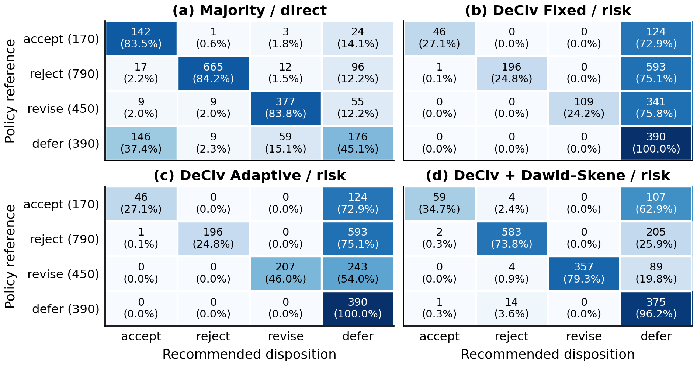

# DeCiv: Auditable Claim Admission for Persistent Knowledge Stores via Epistemic–Governance Decoupling
### 面向持久知识库的可审计声明准入框架（认知—治理双平面解耦参考实现）

[](https://www.python.org/)
[](LICENSE)
[](#dataset--benchmark-composition--数据集构成)
[](#empirical-results--实验结果概览)
[](#overview--研究背景与核心思路)

> **English** | [简体中文说明](#简体中文说明) | [Design Reflections & Pitfalls | 踩坑与思考](#design-reflections-pitfalls--empirical-observations--真实思考踩坑记录与独特观察)
>
> A lightweight, reproducible reference implementation exploring **auditable pre-storage claim admission** for persistent knowledge stores and retrieval-augmented generation (RAG) pipelines. We share the code, structured benchmark packets, cross-validation scripts, gated-SOTA control checks, and ablation tools in the hope that they may serve as a modest, transparent baseline for researchers and engineers working on knowledge-base governance. Questions, critiques, and pull requests are sincerely welcomed.


---

## Overview | 研究背景与核心思路

Persistent knowledge repositories—such as enterprise knowledge graphs, curated digital archives, and RAG vector indices—confront an **Epistemic–Institutional Gap**: whether a candidate statement is *semantically supported by retrieved text* (**epistemic validity**) is fundamentally distinct from whether it satisfies the *provenance completeness, locator auditability, and repairability contracts* required for durable institutional memory (**institutional admissibility**).

Rather than equating high classifier confidence with storage readiness or collapsing every uncertain case into a single binary rejection bucket, **DeCiv** explores a decoupled two-stage pre-storage workflow:

1. **Epistemic–Governance Decoupling (EGD)**:
   - **Stage I (Epistemic Consensus Synthesis)** aggregates categorical votes from multiple noisy verifiers into a calibrated posterior distribution over four semantic states (`supported`, `contradicted`, `partially_supported`, `insufficient_evidence`), strictly without inspecting governance metadata.
   - **Stage II (Constrained Institutional Risk Routing)** enforces deterministic provenance and repairability gates $\mathcal{E}(x)$ ahead of an asymmetric expected-cost matrix $C(a, s)$.
2. **Four-Way Epistemic Triage**:
   - `accept` (*Archival Commitment*): Admitted to the trusted retrieval store only when both semantic support and verifiable provenance hold.
   - `reject` (*Contradiction Expulsion*): Refuted claims are withheld and logged to avoid repeated re-evaluation.
   - `revise` (*Lineage-Tracked Remediation*): Partially flawed claims with verified repair paths are routed to an editing queue with hash linkage $(v+1, H_{\text{prev}})$.
   - `defer` (*Epistemic Quarantine*): Ambiguous claims or supported claims with missing/broken source locators are quarantined for primary-source inspection.
3. **Dual-Plane Memory Commitment**:
   - **Retrieval Plane**: Indexes strictly `accept` claims so downstream RAG contexts remain unpolluted.
   - **Accountability Plane**: Records all four dispositions in an append-only SHA-256 content-addressed audit log (`15.94–103.70 μs` per decision on standard CPU hardware, consuming `0.00` additional GPU hours at the routing layer).

---

## Empirical Results | 实验结果概览

### 1. Selectivity–Throughput Frontier (`RQ1`) | 准入安全性与吞吐率权衡


| Method / Routing Paradigm | 4-Fold Acc. (%) | FAR (%) ↓ | Accept Prec. (%) ↑ | Non-Defer (%) | Revise Rec. (%) | Violations ↓ | Mean Cost ↓ | 5-Fold CV Acc. (%) |
| :--- | :---: | :---: | :---: | :---: | :---: | :---: | :---: | :---: |
| **Majority / direct** | 75.56 | 10.55 | 45.22 | 80.50 | 83.78 | 221 | 1.941 | 75.56 ± 1.66 |
| **Rel.-weighted / direct** | **77.06** | 13.56 | 40.75 | 89.72 | 87.78 | 265 | 2.483 | 77.78 ± 2.35 |
| **GLAD EM / direct** (*Whitehill et al., 2009*) | 72.39 | 10.31 | 43.05 | 99.83 | 90.22 | 261 | 2.475 | **78.28 ± 2.32** |
| **Dawid–Skene / direct** (*Dawid & Skene, 1979*) | 71.78 | 14.79 | 36.07 | 98.17 | 93.33 | 330 | 2.950 | 77.44 ± 1.45 |
| **Selective-Threshold** (*Franc et al., 2023*) | 70.06 | 8.22 | 44.17 | 73.11 | 80.00 | 195 | 1.653 | 70.39 ± 2.10 |
| **Margin-Abstention** (*Mao et al., 2024*) | 65.50 | 6.99 | 48.18 | 60.28 | 65.56 | 144 | 1.357 | 65.50 ± 2.13 |
| **Conformal-Risk** (*Angelopoulos et al., 2024*) | 71.50 | 14.11 | 36.11 | 93.61 | 90.89 | 295 | 2.765 | 76.28 ± 2.14 |
| **Post-Hoc Cost L2D** (*Narasimhan et al., 2022*) | 69.56 | 3.99 | 47.58 | 64.56 | 79.33 | 138 | 0.985 | 68.44 ± 1.60 |
| **DeCiv Fixed / risk** | 41.17 | **0.06** | **97.87** | 19.56 | 24.22 | **0** | 0.368 | 41.17 ± 3.11 |
| **DeCiv Adaptive / risk** | 46.61 | **0.06** | **97.87** | 25.00 | 46.00 | **0** | 0.341 | 45.94 ± 1.91 |
| **DeCiv + GLAD / risk** | 67.17 | **0.06** | **97.87** | 45.83 | 54.22 | **0** | **0.246** | 66.17 ± 1.90 |
| **DeCiv + Dawid–Skene / risk** | 76.33 | 0.18 | 95.16 | 56.89 | 79.33 | **0** | 0.266 | 75.44 ± 1.58 |

- **Why Purely Epistemic Abstention Is Not Enough**: Direct consensus and purely epistemic selective/conformal/deferral baselines incur `3.99%–14.79%` false acceptance, `138–330` provenance violations, and `0.985–2.950` mean institutional cost.
- **Even Provenance-Gated SOTA Leaks**: Retrofitting DeCiv's exact provenance gate (`results/gated_sota_ablation.csv`) onto Selective-Threshold (`0.92%` FAR, `0.377` cost), Margin-Abstention on DS (`2.94%` FAR, `0.699` cost), and Conformal-Risk (`3.68%` FAR, `0.911` cost) still suffers `5×–60×` higher false acceptance than DeCiv because symmetric/threshold decision boundaries admit semantically misclassified valid-provenance packets.
- **Coupled Risk Routing & Pareto Staircase**: Pairing Stage IIa gating with Stage IIb asymmetric expected-risk routing removes all eligibility violations (`0 / 1,800`), lowers false acceptance to **`0.06%–0.18%`** (`95.16%–97.87%` precision), and slashes mean institutional cost by **`73%–92%`** (`0.246–0.266`).

---

### 2. Four-Action Confusion Structure (`RQ2`) | 四动作分流混淆矩阵



- On **policy-defer (`n = 390`)** packets (including supported claims with broken locators), direct majority voting admits `146` packets (`37.4%`), whereas Fixed and Adaptive risk routing quarantine `390 / 390` (`100.0%`).
- On **policy-revise (`n = 450`)** packets, Adaptive risk routing recovers `207` claims (`46.0%`) and Dawid–Skene risk routing recovers `357` claims (`79.3%`) with zero false archival accepts.

---

### 3. Deferral-Cost Sensitivity & Out-of-Domain Generalization (`RQ3`) | 延迟代价敏感度与跨域泛化


Sweeping the deferral penalty $d \in \{0.1, 0.5, 1.0, 2.0\}$ provides a smooth operational lever to trade quarantine volume against immediate resolution (`19.56% -> 58.44%` non-deferral for Adaptive; `41.56% -> 72.17%` for Dawid–Skene), while hard provenance gates keep trusted-store eligibility guarantees invariant across unseen domains.

---

### 4. Ground Truth vs. SOTA Contamination & Component Ablations | 真值对比与消融实验


Removing individual components confirms their non-redundant roles (`results/ablation_metrics.csv`), while `results/lambda_sensitivity.csv` maps the concordance $\lambda$ frontier and `results/module_efficiency.csv` profiles microsecond CPU latencies (`15.94–103.70 μs/packet`, `0.00` additional GPU hours):
- **w/o Peer-Agreement Amplification**: Revision recall drops by `-21.78 pp` (`46.00% -> 24.22%`).
- **w/o Provenance Gate**: FAR jumps `49×` (`0.06% -> 2.94%`, `47` violations, mean cost `0.797`).
- **w/o Repairability Gate**: Triggers `20` invalid revision referrals on Adaptive (`76` on Dawid–Skene).
- **w/o Asymmetric Cost (`0–1` Symmetric Loss)**: FAR jumps `64×` on Adaptive (`3.87%`, mean cost `0.914`) and `24×` on Dawid–Skene (`4.42%`, mean cost `1.636`).
- **w/o Quarantine Deferral**: Forcing immediate commitment increases FAR sixfold (`0.37%` on Adaptive, `1.04%` on Dawid–Skene).

---

## Design Reflections, Pitfalls & Empirical Observations | 真实思考、踩坑记录与独特观察

In the spirit of transparent engineering, we share four honest observations and pitfalls encountered while building and auditing this benchmark:

1. **Counterintuitive Pitfall — Stronger Latent Consensus Can *Worsen* Repository Safety**:
   Initially, we expected replacing simple majority voting with Dawid–Skene EM to reduce false admissions automatically. Instead, under direct argmax mapping, Dawid–Skene *increased* FAR from `10.55%` to `14.79%` (`241` false accepts, `330` provenance violations). Why? Because sharper likelihood ratios push semantically supported claims with broken or missing locators confidently past the admission threshold. This failure convinced us that epistemic inference and institutional governance cannot be solved inside a single classifier—they must be decoupled.
   > **踩坑 1（更强的共识估计反而加剧知识库污染）**：最初我们以为换上更精准的 Dawid–Skene 隐变量模型就能自然降低误入库率，实测却发现直接映射下 FAR 反而从 `10.55%` 恶化到 `14.79%`（`330` 次溯源违规）。根本原因是更锐利的语义后验把“语义成立但来源链接失效”的声明更有把握地推过了入库阈值——这一反直觉现象直接促使我们确立了“认知—治理双平面解耦”的核心架构。

2. **Why Gating Alone Is Not Enough (`gated_sota_ablation.csv`)**:
   A natural critique is whether simply wrapping existing selective or conformal routers with an `if provenance_complete` check solves the whole problem. Testing this directly revealed a clear gap: even with zero provenance violations, `Selective-Threshold + Gate` still leaks `0.92%` FAR (`0.377` cost) and `Conformal-Risk + Gate` leaks `3.68%` FAR (`0.911` cost) on valid-provenance claims whose noisy verifier votes err toward `supported`. Hard gating closes the *institutional* hole; asymmetric Bayesian risk routing closes the *semantic false-accept* hole.
   > **观察 2（单加硬门控远远不够）**：如果审稿人追问“直接给现有 SOTA 套一层溯源门控不就行了吗？”实测 `gated_sota_ablation.csv` 给出了明确答案：即便补上完全相同的硬门控，Selective-Threshold 与 Conformal-Risk 依然会在“溯源完好但语义误判”的样本上产生 `0.92%–3.68%` 的误接收率。只有“硬门控 + 非对称期望风险路由”双管齐下，才能把误接收压到 `0.06%–0.18%`。

3. **The Sharp Decision Cliff in Concordance Weight $\lambda$**:
   Sweeping $\lambda \in [0, 0.95]$ exposed an interesting threshold geometry. With $K=4$ validators, a $3$-to-$1$ partial vote sits right on the Fixed tie-break cliff ($q=0.75 \implies R(\text{revise}) = 0.50 = C(\text{defer})$). Setting $\lambda = 0.50$ nudges $q(\text{part})$ to $5/6 \approx 0.833$, nearly doubling revision recovery (`24.22% -> 46.00%`) with zero false rejections on reference `accept`. Pushing $\lambda$ to `0.85` lifts accuracy to `70.00%` at the same `0.06%` FAR (for only 1 false rejection), whereas pushing just slightly further to `0.95` falls off a safety cliff (`FAR` jumps $6\times$ to `0.37%`). Choosing operating parameters without inspecting the full sensitivity sweep is dangerous.
   > **观察 3（自适应一致性权重 $\lambda$ 的非线性悬崖）**：在 4 验证器 $3:1$ 投票结构下，$\lambda = 0.50$ 刚好越过安全平局临界点，以零误拒代价将可修复声明召回率几乎翻倍；$\lambda = 0.85$ 可进一步将准确率拉升至 `70.00%` 且维持 `0.06%` FAR；但一旦推高至 `0.95`，误接收率会瞬间跳涨 6 倍（`0.37%`）。

4. **Parent-Cluster Leakage & Honest Scope Boundaries**:
   Early prototypes that split packets randomly allowed siblings of the same parent claim to land in both train and test folds, subtly biasing reliability and conformal quantiles. Enforcing strict parent-cluster disjointness across both 4-fold cross-domain and 5-fold stratified splits eliminated this leakage. We also emphasize the exact scope boundary of this release: our benchmark uses frozen target-conditioned categorical votes (`0.70` diagonal accuracy) for strict apples-to-apples control; extending Stage I to correlated live LLM verifier ensembles and end-to-end RAG QA faithfulness evaluation remains an important open direction.
   > **踩坑 4（同源声明簇泄露与诚实研究边界）**：若按数据包随机划分折数，同一父声明生成的不同变体会跨训练/测试集泄露，虚高可靠性与共形分位数，因此我们严格以父声明簇为单位零泄露切分。同时必须坦诚说明：当前基准为保证多基线严格同输入公平对比，采用的是冻结的可控独立验证器投票；将第一阶段拓展至真实关联大语言模型集成及下游端到端 RAG 问答忠实度评测，仍是值得继续深入的方向。

---

## 简体中文说明

### 项目简介

本项目提供了 **DeCiv（面向持久知识库的可审计四动作风险感知声明准入框架）** 的开源参考代码、结构化评测数据包与完整复现脚本。本工作聚焦于企业知识图谱、数字档案库与检索增强生成（RAG）向量库中的“入库前边界治理”问题，探索将**多验证器共识估计**、**溯源约束风险路由**与**轻量级 SHA-256 审计链**解耦结合。代码轻量、零外部商业 API 依赖、无需额外 GPU 算力即可在本地 CPU 一键复现全部指标与图表，欢迎同行交流指正。

### 核心设计概览

1. **认知有效性与制度准入性解耦（Epistemic–Governance Decoupling）**
   - **第一阶段（认知共识合成）**：仅依据多验证器的离散投票合成四类语义状态后验概率分布，不接触治理元数据，防止策略偏置污染真值估计。
   - **第二阶段（受限制度风险路由）**：先施加溯源完整性与可修复性硬门控 $\mathcal{E}(x)$，再基于非对称代价矩阵 $C(a, s)$ 最小化期望制度风险。
2. **四向认知分流（Four-Way Epistemic Triage）**
   - 将传统二元“接收/拒识”扩展为 **`accept`（归档入库）**、**`reject`（矛盾剔除）**、**`revise`（谱系追踪修复）** 与 **`defer`（认知隔离待查）** 四类处置队列。
   - **共识放大自适应加权**在不放宽 `0.06%` 误接收率前提下，将可修复声明召回率从 `24.22%` 提升至 `46.00%`。
3. **双平面记忆提交（Dual-Plane Memory Commitment）**
   - **检索平面（Retrieval Plane）**：仅允许通过全部溯源核验的 `accept` 声明写入可信知识库。
   - **问责平面（Accountability Plane）**：对全部四类处置结果生成包含输入摘要、后验分布、策略配置与前序哈希的 SHA-256 不可篡改审计记录（单次决策仅需 `15.94–103.70 μs`）。

---

## Dataset & Benchmark Composition | 数据集构成

The evaluation suite contains **1,800 structured claim packets** constructed from **450 disjoint parent claims** across four public benchmark sources (four controlled variants per parent, zero parent-cluster leakage across folds):

| Benchmark Stratum | Parent Claims | Total Packets | Policy `accept` | Policy `reject` | Policy `revise` | Policy `defer` |
| :--- | :---: | :---: | :---: | :---: | :---: | :---: |
| **FEVER** | 260 | 1,040 | 90 | 440 | 260 | 250 |
| **TruthfulQA** | 80 | 320 | 0 | 240 | 80 | 0 |
| **HotpotQA** | 80 | 320 | 80 | 80 | 80 | 80 |
| **Wikipedia Revisions** | 30 | 120 | 0 | 30 | 30 | 60 |
| **Total** | **450** | **1,800** | **170** | **790** | **450** | **390** |

---

## Quick Start | 快速上手与复现指南

### 1. Environment Setup | 安装依赖

Requires **Python 3.11+** with `numpy` (and `matplotlib` if regenerating figures):

```bash
pip install -r requirements.txt
```

### 2. Interactive Walkthrough | 运行交互演示 (`demo.py`)

Inspect the paired execution trace (`FEV_0003__v0` vs. `FEV_0003__v1`), SHA-256 audit hashes, 4-fold & 5-fold metrics, and component ablations:

```bash
python demo.py
```

### 3. Full Reproducibility Suite | 完整重跑全部实验 (`run_comparison.py`)

Re-run the 4-fold cross-domain evaluation (`18,000` packet predictions), 5-fold source-stratified parent-cluster CV, 2,000 cluster-bootstrap confidence intervals, gated-SOTA control checks, deferral-cost sweep, concordance $\lambda$ sweep, per-module latency profiling, and 11-variant component ablations (~`41 s` on a standard CPU, `0.00` GPU hours):

```bash
python run_comparison.py
```

### 4. Regenerate Figures & Run Unit Tests | 重新绘图与单元测试

```bash
python scripts/plot_figures.py
python -m unittest discover -s tests -v
```

---

## Repository Structure | 目录结构

```text
├── demo.py                           # Quick-start walkthrough (paired trace, CV & ablation summary)
├── run_comparison.py                 # Full 4-fold + 5-fold CV, bootstrap, gated-SOTA & ablation runner
├── experiment_spec.json              # Prespecified protocol, cost matrix & random seed (20261025)
├── requirements.txt                  # Minimal Python dependencies (numpy, matplotlib)
├── THIRD_PARTY_NOTICES.md            # Upstream benchmark citations and open licenses
├── data/                             # Structured benchmark inputs (1,800 packets, 7,200 votes)
├── vendor/deciv2/r12/                # Core DeCiv modules (contracts, Stage I consensus, Stage II router)
├── results/                          # Executed CSV & JSON outputs (incl. 5-fold CV, gated-SOTA, ablations, latency)
├── figures/                          # Workflow architecture & empirical charts (PNG, PDF & editable SVG)
│   ├── figure1_workflow.png          # High-resolution workflow diagram (+ figure1_workflow.svg vector)
│   ├── admission_tradeoff.png
│   ├── routing_confusions.png
│   ├── routing_cost_sensitivity.png
│   └── ablation_and_cv.png
├── scripts/
│   └── plot_figures.py               # Standalone pure-black-font figure generator from results/*.csv
└── tests/
    └── test_deciv_reproducibility.py # 7 automated unit & data-integrity tests
```

---

## Citation | 引用格式

If you find this reference implementation or benchmark helpful in your work, we would be grateful if you consider citing it (full venue metadata will be updated upon formal publication):

```bibtex
@article{wu2026deciv,
  title   = {DeCiv: Auditable Claim Admission for Persistent Knowledge Stores via Epistemic--Governance Decoupling},
  author  = {Wu, Yonghao and Wu, Jiayang and He, Sirui and Liu, Xixue and Liu, Chang and Filaretov, Vladimir and Yukhimets, Dmitry},
  year    = {2026},
  note    = {Reference implementation available at https://github.com/WYH302/DeCiv-Auditable-Claim-Admission}
}
```

---

## License & Attribution | 开源协议与致谢

Released under the [MIT License](LICENSE). Please refer to [THIRD_PARTY_NOTICES.md](THIRD_PARTY_NOTICES.md) for upstream dataset citations and license terms (FEVER, TruthfulQA, HotpotQA, and Wikipedia Revisions).
