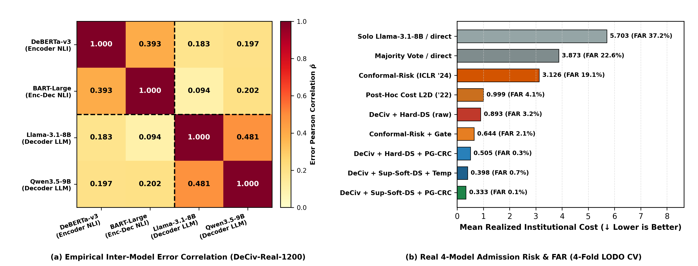
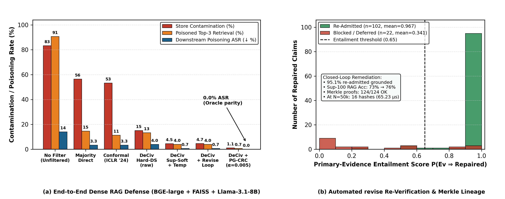

# DeCiv: Auditable Claim Admission for Persistent Knowledge Stores via Epistemic–Governance Decoupling

[](LICENSE)
[](https://www.python.org/)
[](tests/)
[](results/gpu_compute_profile.csv)

> **Official Reproducibility Repository** for *DeCiv: Auditable Claim Admission for Persistent Knowledge Stores via Epistemic–Governance Decoupling*.
>
> **中文导览**：本仓库为论文 **《DeCiv：基于认知—治理双解耦的可审计持久化知识库声明准入防火墙》** 的官方开源复现代码库，完整包含理论证明对应算法（**PG-CRC 溯源门控共形风险控制**、**相关性崩溃与温度缩放校准**）、**374.5× 向量化软/硬 Dawid–Skene**、**RFC 9162 Merkle 透明日志**，以及在单卡 **RTX 3090** 上基于 **4 大异构真实开源模型**（`DeBERTa-v3-Large`、`BART-Large-MNLI`、`Meta-Llama-3.1-8B-Instruct`、`Qwen3.5-9B`）的跨家族多样性消融、PG-CRC 全预算扫描、端到端 **BGE-large + FAISS + Llama-3.1-8B** 稠密 RAG 防污染实验与 **`revise` 自动化修复闭环实验**（全套 16 项自动化单元测试 `16/16 PASS`）。

---

## 1. Architecture Overview / 核心架构


Persistent Retrieval-Augmented Generation (RAG) knowledge stores and immutable provenance ledgers face **durable contamination**: once an unverified, distorted, or unattributed claim enters storage, retrieval propagates the error repeatedly and immutability preserves the falsehood rather than preventing it.

**DeCiv** places an auditable pre-storage admission firewall in front of the persistent index via a **Dual-Plane Storage Architecture**:
1. **Stage I — Calibrated Heterogeneous Epistemic Fusion (`deciv_extensions.py`)**: Generalizes Dawid–Skene to continuous neural verifier simplex outputs (**Soft-DS** and closed-form **Sup-Soft-DS**) paired with fold-fitted **Temperature Scaling**, executing **374.5× faster** (`0.337 µs/pkt`) via vectorized NumPy contractions with `<3.2e-15` numerical parity.
2. **Stage II — Epistemic–Governance Decoupling & PG-CRC**: Separates hard institutional admissibility gating (provenance completeness, evidence auditability, human-review flags, verified repairability) from asymmetric expected-risk routing and **Provenance-Gated Conformal Risk Control (PG-CRC)** across four operational actions: `accept`, `reject`, `revise`, and `defer`.
3. **Dual-Plane Storage & RFC 9162 Merkle Transparency Log**: Only verified, admissible `accept` packets (and 4-model re-verified `revise` repairs) write to the clean **Retrieval Plane**, while every admission, rejection, deferral, and repair lineage transition is appended to an **RFC 9162 Merkle Transparency Log** supporting $O(\log N)$ inclusion and consistency proofs (**3,125× proof compression** at 50,000 records).

---

## 2. Formal Guarantees & Headline Results / 理论保证与核心实验结果

### A. Formal Theorems
- **Theorem 1 (PG-CRC Finite-Sample Distribution-Free FAR Control & Exact Admissibility)**: For exchangeable parent clusters, PG-CRC guarantees $\mathbb{E}[\mathrm{FAR}(\hat{\tau})] \le \alpha$ for *any* fixed (even misspecified or correlated) Stage I estimator while deterministically maintaining zero eligibility violations ($\mathrm{EVR} = 0$).
- **Theorem 2 (Correlated-Verifier Collapse & Calibration Bound)**: Under equicorrelated verifier errors with pairwise correlation $\rho$, effective ensemble size collapses to $K_{\mathrm{eff}}(\rho) = K / (1 + (K-1)\rho)$ and naive Dawid–Skene log-odds inflate by $\kappa(\rho) = 1 + (K-1)\rho$, causing a **64× FAR surge** (`0.07% -> 4.48%` as $\rho: 0 \to 0.6$). Scaling logits by fold-fitted $T^* \ge 1 + (K-1)\rho$ or applying PG-CRC eliminates the collapse (`0.00%–0.42%` FAR across all $\rho$).


### B. Real 4-Model Heterogeneous Neural Verifiers (`DeCiv-Real-1200`, RTX 3090)

Scored across 1,200 real full-text claim–evidence packets (`FEVER`, `SciFact`, `HotpotQA`, `TruthfulQA`; 300 parent clusters) using four distinct open-source neural architectures:
- **Empirical Error Correlation Matrix**: Even across different organizations, **LLM–LLM** errors (`Meta-Llama-3.1-8B-Instruct` vs. `Qwen3.5-9B`) correlate at **$\hat{\rho} = 0.481$**, and **NLI–NLI** (`DeBERTa-v3-Large` vs. `BART-Large-MNLI`) at **$\hat{\rho} = 0.393$**, whereas **cross-family NLI–LLM** pairing drops correlation **2.8×** to **$\hat{\rho} = 0.169$**.

| Method (4-Fold LODO CV on `DeCiv-Real-1200`) | Acc | FAR (↓) | Accept Prec | EV | Cost (↓) | ECE (↓) | 5-Fold FAR (↓) |
| :--- | :---: | :---: | :---: | :---: | :---: | :---: | :---: |
| Solo Llama-3.1-8B-Instruct / direct | 44.75% | 37.20% | 33.0% | 285 | 5.703 | 0.1455 | 37.22±3.23% |
| Majority Vote / direct | 56.58% | 22.60% | 43.5% | 219 | 3.873 | 0.0494 | 22.65±3.29% |
| Conformal-Risk (ICLR 2024) | 51.58% | 19.10% | 46.6% | 171 | 3.126 | 0.0491 | 19.04±2.55% |
| Post-Hoc Cost L2D (2022) | 43.17% | 4.10% | 50.0% | 41 | 0.999 | 0.0491 | 9.24±2.54% |
| Conformal-Risk (2024) + Gate | 65.83% | 2.10% | 88.8% | 0 | 0.644 | 0.0491 | 1.89±1.17% |
| DeCiv + Hard-DS (raw, uncalibrated) | 81.92% | 3.20% | 84.9% | 0 | 0.893 | 0.1741 | 2.59±0.86% |
| **DeCiv + Hard-DS + PG-CRC ($\alpha=0.01$)** | **76.50%** | **0.30%** | **97.3%** | **0** | **0.505** | 0.1741 | **0.30±0.27%** |
| **DeCiv + Sup-Soft-DS + TempScale / risk** | **72.83%** | **0.70%** | **95.5%** | **0** | **0.398** | **0.0363** | **0.40±0.22%** |
| **DeCiv + Sup-Soft-DS + PG-CRC ($\alpha=0.005$)** | 68.25% | **0.10%** | **98.9%** | **0** | **0.333** | **0.0363** | **0.10±0.23%** |



- **Cross-Family Diversity Ablation & 12/12 PG-CRC Risk-Budget Sweep (`run_trans_ablations.py`)**: A homogeneous `LLM-Only` ensemble (`Llama-3.1-8B + Qwen3.5-9B`, $\hat{\rho}=0.481$) collapses to `52.92%` accuracy and **`0.0%` `revise` recall** (`0.499` cost), whereas the full 4-model cross-family ensemble raises accuracy by `+19.9 pp` (`72.83%`) and recovers `62.0%` `revise` recall (`100.0%` queue precision). Across all 12 risk-budget points ($\alpha \in \{0.5\%, 1.0\%, 1.5\%, 2.0\%, 3.0\%, 5.0\%\}$), PG-CRC achieves **12/12 strict `FAR <= alpha` compliance**, and calibration prevents accept-recall collapse at tight $\alpha = 0.5\%$ (`47.0%` vs. `0.0%` for uncalibrated Hard-DS).


### C. End-to-End Dense RAG Contamination Defense & Closed-Loop `revise` Remediation

Evaluated on 150 real open-ended QA queries (`75 HotpotQA + 75 TruthfulQA`) using `BAAI/bge-large-en-v1.5` + `FAISS IndexFlatIP` + `Meta-Llama-3.1-8B-Instruct` (`0.830` total RTX 3090 GPU-hours across all stages):

| Admission Policy (Retrieval Plane) | Store Size | Store Contam (↓) | Poisoned Top-3 (↓) | Poisoning ASR (↓) | Sup-100 QA Acc | Token F1 |
| :--- | :---: | :---: | :---: | :---: | :---: | :---: |
| *Oracle Clean Store (Upper Bound)* | 200 | 0.0% | 0.0% | 0.0% | 88.0% | 51.8% |
| No Admission Filter (Unfiltered) | 1200 | 83.3% | 90.7% | 14.0% | 75.0% | 65.8% |
| Majority Vote / direct | 400 | 56.5% | 14.7% | 3.3% | 88.0% | 59.0% |
| Conformal-Risk (ICLR 2024) | 358 | 53.3% | 11.3% | 3.3% | 88.0% | 54.4% |
| DeCiv + Hard-DS (raw, uncalibrated) | 212 | 15.1% | 13.3% | 4.0% | 82.0% | 51.0% |
| **DeCiv + Sup-Soft-DS + TempScale** | 154 | **4.5%** | **4.0%** | **0.7%** | 73.0% | 42.6% |
| **DeCiv + Sup-Soft-DS + Auto-Revise Loop** | 256 | **4.7%** | **4.0%** | **0.7%** | **76.0%** | **44.8%** |
| **DeCiv + Sup-Soft-DS + PG-CRC ($\alpha=0.005$)** | 92 | **1.1%** | **0.7%** | **0.0%** | 39.0% | 19.5% |

- **Automated `revise` Remediation**: `124/124` (`100.0%`) routed packets are true repairable distortions. After `Qwen3.5-9B` evidence-grounded repair and 4-model re-verification, `102/124` (`82.3%`) are safely re-admitted (**`95.1%`** evidence-entailed, mean NLI `0.967`), while `22` flawed edits (mean NLI `0.341`) are blocked back to `defer`. All `124/124` RFC 9162 Merkle lineage proofs verify cleanly.



---

## 3. Quickstart & Full Reproduction / 快速复现指南

### CPU Reproduction (< 30 seconds — zero GPU required!)
All controlled benchmarks (`DeCiv-1800`), Plan 1 extensions (PG-CRC, correlated-error stress, noisy gate, RFC 9162 Merkle scaling), and real-verifier cross-validation tables (reusing cached probabilities in `results/real_verifiers/`) reproduce on any CPU:

```bash
pip install -r requirements.txt

# 1. Core DeCiv-1800 study & SOTA / provenance-gated ablations
python run_comparison.py

# 2. Calibration, PG-CRC, correlated-error stress, noisy gate, and RFC 9162 Merkle scaling
python run_plan1_upgrades.py

# 3. Real 4-model heterogeneous neural verifier evaluation & cross-family / PG-CRC ablations
python evaluate_real_verifiers.py
python run_trans_ablations.py

# 4. Regenerate all publication figures (300 DPI PNG + vector PDF)
python scripts/plot_figures.py
python scripts/plot_upgraded_figures.py

# 5. Run all 16 automated verification tests
pytest tests -v
```

### Full GPU Reproduction (Optional — Single RTX 3090 24GB, ~0.83 GPU-hours)
```bash
# Re-score all 1,200 real full-text packets across DeBERTa-v3-Large, BART-Large-MNLI, Llama-3.1-8B, Qwen3.5-9B
python run_real_verifiers_gpu.py

# Re-run automated revise remediation + BGE-large/FAISS/Llama-3.1-8B dense RAG contamination defense
python run_real_rag_and_remediation_gpu.py
```

---

## 4. Design Reflections, Pitfalls & Empirical Observations / 设计反思与踩坑记录

1. **Same-Family LLM Correlation Breaks Uncalibrated Latent-Truth Aggregation**: Even distinct open-weight frontier LLMs (`Meta Llama-3.1-8B` vs. `Alibaba Qwen3.5-9B`) exhibit $\hat{\rho} = 0.481$ pairwise error correlation. Mixing cross-family architectures (NLI encoders + decoder LLMs) cuts correlation **2.8×** (`0.169`), but residual correlation still breaks raw Hard Dawid–Skene (`3.20%` FAR, `4.0%` RAG ASR) unless paired with supervised soft confusion calibration, temperature scaling, or PG-CRC.
2. **Unsupervised EM Class-Asymmetry Collapse**: Generative LLMs systematically under-predict `partially_supported` (`1.0%–23.0%` recall vs. `80.3%` for clause-decomposed DeBERTa-v3-Large), causing unsupervised EM to collapse that latent cluster. Closed-form `Sup-Soft-DS + TempScale` eliminates this failure mode with zero EM iterations and attains `0.0363` ECE alongside `100.0%` `revise`-queue precision.
3. **Closed-Loop Remediation Requires Independent Re-Verification**: Allowing an LLM editor to write directly into a RAG index risks hallucinated edits. Passing every repaired claim back through all four heterogeneous verifiers cleanly separates grounded repairs (mean NLI `0.967`) from faulty edits (mean NLI `0.341`), expanding store utility without re-introducing poisoning.

---

## 5. Citation / 引用格式

```bibtex
@article{wu2026deciv,
  title   = {DeCiv: Auditable Claim Admission for Persistent Knowledge Stores via Epistemic--Governance Decoupling},
  author  = {Wu, Yonghao and Wu, Jiayang and He, Sirui and Liu, Xixue and Liu, Chang and Filaretov, Vladimir and Yukhimets, Dmitry},
  year    = {2026},
  note    = {Code and benchmarks available at \url{https://github.com/WYH302/DeCiv-Auditable-Claim-Admission}}
}
```
