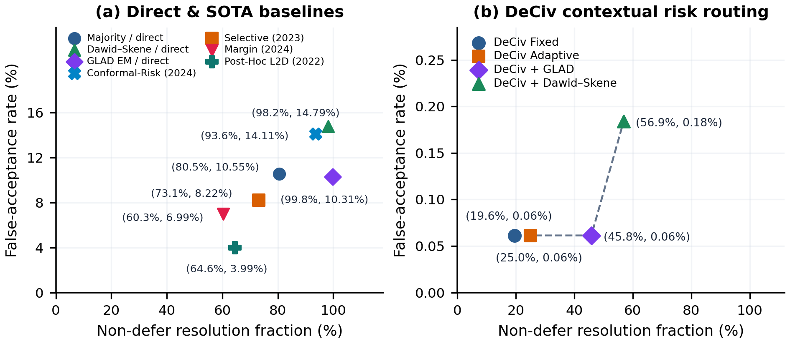
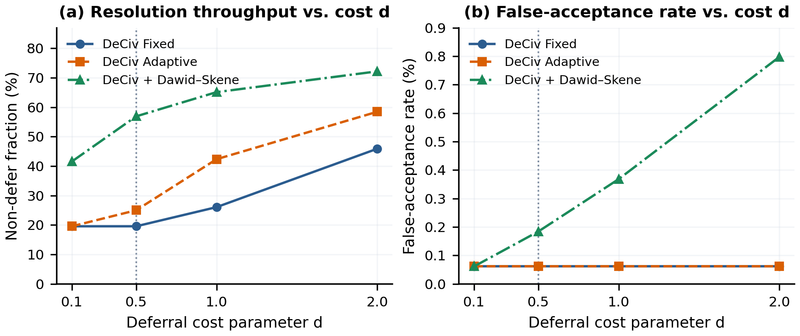
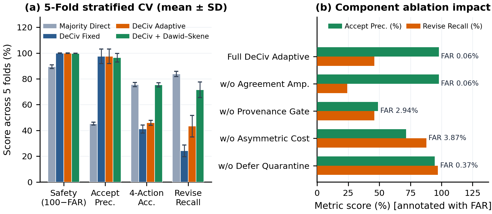

# DeCiv: Auditable Claim Admission for Persistent Knowledge Stores via Epistemic–Governance Decoupling
### 面向持久知识库的可审计声明准入框架（认知—治理双平面解耦参考实现）

[](https://www.python.org/)
[](LICENSE)
[](#dataset--benchmark-composition--数据集构成)
[](#empirical-results--实验结果概览)
[](#overview--研究背景与核心思路)

> **English** | [简体中文说明](#简体中文说明)
>
> A lightweight, reproducible reference implementation exploring **auditable pre-storage claim admission** for persistent knowledge stores and retrieval-augmented generation (RAG) pipelines. We share the code, structured benchmark packets, cross-validation scripts, and ablation tools in the hope that they may serve as a useful baseline for researchers and practitioners interested in knowledge-store governance. Feedback, issues, and suggestions are warmly welcomed.


---

## Overview | 研究背景与核心思路

Persistent knowledge repositories—such as enterprise knowledge graphs, curated digital archives, and RAG vector indices—face an **Epistemic–Institutional Gap**: whether a candidate statement is *semantically supported by retrieved text* (**epistemic validity**) does not by itself guarantee that it meets the *provenance completeness, locator auditability, and repairability criteria* required for long-term storage (**institutional admissibility**).

Rather than treating high classifier confidence as an automatic write permission or collapsing all non-admitted items into a single binary abstention bucket, **DeCiv** explores a decoupled two-stage pre-storage workflow:

1. **Epistemic–Governance Decoupling (EGD)**:
   - **Stage I (Epistemic Consensus Synthesis)** aggregates categorical votes from multiple noisy verifiers into a calibrated posterior distribution over four semantic states (`supported`, `contradicted`, `partially_supported`, `insufficient_evidence`), without reading governance metadata.
   - **Stage II (Constrained Institutional Risk Routing)** enforces hard provenance and repairability gates $\mathcal{E}(x)$ together with an asymmetric expected-cost matrix $C(a, s)$.
2. **Four-Way Epistemic Triage**:
   - `accept` (*Archival Commitment*): Admitted to the trusted retrieval store only when both semantic support and verifiable provenance hold.
   - `reject` (*Contradiction Expulsion*): Refuted claims are withheld and logged to avoid repeated re-evaluation.
   - `revise` (*Lineage-Tracked Remediation*): Partially flawed claims with verified repair paths are routed to an editing queue with hash linkage $(v+1, H_{\text{prev}})$.
   - `defer` (*Epistemic Quarantine*): Ambiguous claims or supported claims with missing/broken source locators are quarantined for primary-source review.
3. **Dual-Plane Memory Commitment**:
   - **Retrieval Plane**: Indexes strictly `accept` claims so downstream RAG contexts remain clean.
   - **Accountability Plane**: Records all four dispositions in an append-only SHA-256 content-addressed audit log (`~19.1 μs` per decision on standard CPU hardware, requiring `0.00` additional GPU hours at the routing layer).

---

## Empirical Results | 实验结果概览

### 1. Selectivity–Throughput Frontier (`RQ1`) | 准入安全性与吞吐率权衡



| Method / Routing Paradigm | 4-Fold Acc. (%) | FAR (%) ↓ | Accept Prec. (%) ↑ | Non-Defer (%) | Revise Rec. (%) | Violations ↓ | 5-Fold CV Acc. (%) |
| :--- | :---: | :---: | :---: | :---: | :---: | :---: | :---: |
| **Majority / direct** | 75.56 | 10.55 | 45.22 | 80.50 | 83.78 | 221 | 75.56 ± 1.66 |
| **Rel.-weighted / direct** | 77.06 | 13.56 | 40.75 | 89.72 | 87.78 | 265 | 77.78 ± 2.35 |
| **GLAD EM / direct** (*Whitehill et al., 2009*) | 72.39 | 10.31 | 43.05 | 99.83 | 90.22 | 261 | 78.28 ± 2.32 |
| **Dawid–Skene / direct** (*Dawid & Skene, 1979*) | 71.78 | 14.79 | 36.07 | 98.17 | 93.33 | 330 | 77.44 ± 1.45 |
| **Selective-Threshold** (*Franc et al., 2023*) | 70.06 | 8.22 | 44.17 | 73.11 | 80.00 | 195 | 70.39 ± 2.10 |
| **Margin-Abstention** (*Mao et al., 2024*) | 65.50 | 6.99 | 48.18 | 60.28 | 65.56 | 144 | 65.50 ± 2.13 |
| **Conformal-Risk** (*Angelopoulos et al., 2024*) | 71.50 | 14.11 | 36.11 | 93.61 | 90.89 | 295 | 76.28 ± 2.14 |
| **Post-Hoc Cost L2D** (*Narasimhan et al., 2022*) | 69.56 | 3.99 | 47.58 | 64.56 | 79.33 | 138 | 68.44 ± 1.60 |
| **DeCiv Fixed / risk** | 41.17 | **0.06** | **97.87** | 19.56 | 24.22 | **0** | 41.17 ± 3.11 |
| **DeCiv Adaptive / risk** | 46.61 | **0.06** | **97.87** | 25.00 | 46.00 | **0** | 45.94 ± 1.91 |
| **DeCiv + GLAD / risk** | 67.17 | **0.06** | **97.87** | 45.83 | 54.22 | **0** | 66.17 ± 1.90 |
| **DeCiv + Dawid–Skene / risk** | **76.33** | 0.18 | 95.16 | **56.89** | **79.33** | **0** | 75.44 ± 1.58 |

- **Why Purely Epistemic Abstention Is Not Enough**: Direct consensus and modern selective/deferral baselines (*Franc et al., 2023*; *Mao et al., 2024*; *Narasimhan et al., 2022*) still incur `3.99%–14.79%` false acceptance and `138–330` provenance violations when semantically supported claims carry missing or broken locators.
- **Provenance-Constrained Risk Routing**: Combining metadata gates with asymmetric risk routing removes all eligibility violations (`0 / 1,800`) and lowers false acceptance to **`0.06%`** (`97.87%` accept precision).
- **Four-Tier Pareto Staircase**: Across `DeCiv Fixed` (`41.17%`), `DeCiv Adaptive` (`46.61%`, `+90%` revision recovery), `DeCiv + GLAD` (`67.17%`), and `DeCiv + Dawid–Skene` (`76.33%`), stronger latent consensus smoothly expands resolution throughput while maintaining `0.06%–0.18%` FAR.

---

### 2. Four-Action Confusion Structure (`RQ2`) | 四动作分流混淆矩阵


- On **policy-defer (`n = 390`)** packets (including supported claims with broken locators), direct majority voting admits `146` packets (`37.4%`), whereas Fixed and Adaptive risk routing quarantine `390 / 390` (`100.0%`).
- On **policy-revise (`n = 450`)** packets, Adaptive risk routing recovers `207` claims (`46.0%`) and Dawid–Skene risk routing recovers `357` claims (`79.3%`) with zero false archival accepts.

---

### 3. Deferral-Cost Sensitivity & Out-of-Domain Generalization (`RQ3`) | 延迟代价敏感度与跨域泛化



Sweeping the deferral penalty $d \in \{0.1, 0.5, 1.0, 2.0\}$ provides a smooth operational knob to trade quarantine volume against immediate resolution (`19.56% -> 58.44%` non-deferral for Adaptive; `41.56% -> 72.17%` for Dawid–Skene), while hard provenance gates prevent ungrounded claims from entering trusted storage across held-out domains.

---

### 4. Multi-Metric SOTA Comparison & Component Ablations | 多指标 SOTA 对比与模块消融实验



Removing individual components confirms their complementary roles (`results/ablation_metrics.csv`), while `results/lambda_sensitivity.csv` verifies $\lambda = 0.50$ optimality on the strict zero-false-rejection frontier and `results/module_efficiency.csv` profiles microsecond CPU latencies (`19.14–101.12 μs/packet`, `0.00` additional GPU hours):
- **w/o Peer-Agreement Amplification**: Revision recall drops by `-21.78 pp` (`46.00% -> 24.22%`).
- **w/o Provenance Gate**: FAR rises from `0.06%` to `2.94%` (`47` provenance violations; accept precision drops to `48.94%`).
- **w/o Repairability Gate**: Produces `20` invalid revision referrals on Adaptive (`76` on Dawid–Skene).
- **w/o Asymmetric Cost (`0–1` Symmetric Loss)**: FAR rises to `3.87%` on Adaptive (`4.42%` on Dawid–Skene).
- **w/o Quarantine Deferral**: Forcing immediate commitment increases FAR sixfold (`0.37%` on Adaptive, `1.04%` on Dawid–Skene).

---

## 简体中文说明

### 项目简介

本项目提供了 **DeCiv（面向持久知识库的可审计四动作风险感知声明准入框架）** 的开源参考代码、结构化评测数据包与完整复现脚本。本工作主要面向企业知识图谱、数字档案库及检索增强生成（RAG）向量库中的“入库前边界治理”问题，是一次将**多验证器共识估计**、**溯源约束风险路由**与**轻量级密码学审计链**结合的探索性尝试。代码简洁轻量，无需调用外部商业 API 或消耗额外 GPU 算力即可在本地完整复现实验结果，欢迎各位同行批评指正与交流探讨。

### 核心设计概览

1. **认知有效性与制度准入性解耦（Epistemic–Governance Decoupling）**
   - **第一阶段（认知共识合成）**：仅根据多验证器的离散投票合成四类语义状态（支持、矛盾、部分支持、证据不足）的后验概率分布，不接触治理元数据，避免策略偏置污染真值估计。
   - **第二阶段（受限制度风险路由）**：结合溯源完整性与可修复性硬门控 $\mathcal{E}(x)$ 以及非对称代价矩阵 $C(a, s)$，最小化期望制度风险。
2. **四向认知分流（Four-Way Epistemic Triage）**
   - 将传统的二元“接收/拒识”细化为四种生命周期处置动作：**`accept`（归档入库）**、**`reject`（矛盾剔除）**、**`revise`（带谱系追踪的编辑修复）** 与 **`defer`（认知隔离待查）**。
   - 引入**共识放大自适应加权（Consensus-Amplified Adaptive Weighting）**，在不放宽 `0.06%` 误接收率的前提下，将可修复声明的召回率从 `24.22%` 提升至 `46.00%`。
3. **双平面记忆提交（Dual-Plane Memory Commitment）**
   - **检索平面（Retrieval Plane）**：仅允许通过全部溯源核验的 `accept` 声明写入可信知识库，降低下游 RAG 幻觉传播风险。
   - **问责平面（Accountability Plane）**：对全部四类处置结果生成包含输入摘要、后验分布、策略配置与前序版本哈希的 SHA-256 审计记录（单次决策耗时约 `19.1 μs`）。

---

## Dataset & Benchmark Composition | 数据集构成

The evaluation suite contains **1,800 structured claim packets** constructed from **450 disjoint parent claims** across four public benchmark sources (each parent instantiated across intact verified, provenance-dropout, repairable-corruption, and contradiction variants, with zero parent-cluster leakage across folds):

| Benchmark Stratum | Parent Claims | Total Packets | Policy `accept` | Policy `reject` | Policy `revise` | Policy `defer` |
| :--- | :---: | :---: | :---: | :---: | :---: | :---: |
| **FEVER** | 260 | 1,040 | 90 | 440 | 260 | 250 |
| **TruthfulQA** | 80 | 320 | 0 | 240 | 80 | 0 |
| **HotpotQA** | 80 | 320 | 80 | 80 | 80 | 80 |
| **Wikipedia Revisions** | 30 | 120 | 0 | 30 | 30 | 60 |
| **Total** | **450** | **1,800** | **170** | **790** | **450** | **390** |

---

## Quick Start | 快速上手与复现指南

### 1. Environment Setup | 安装依赖

Requires **Python 3.11+** with `numpy` (and `matplotlib` if regenerating figures):

```bash
pip install -r requirements.txt
```

### 2. Interactive Walkthrough | 运行交互演示 (`demo.py`)

Inspect the paired execution trace (`FEV_0003__v0` vs. `FEV_0003__v1`), SHA-256 audit hashes, 4-fold & 5-fold metrics, and component ablations:

```bash
python demo.py
```

### 3. Full Reproducibility Suite | 完整重跑全部实验 (`run_comparison.py`)

Re-run the 4-fold cross-domain evaluation (`18,000` packet predictions), 5-fold source-stratified parent-cluster cross-validation, 2,000 cluster-bootstrap confidence intervals, deferral-cost sweep, and 11-variant component ablations (completes in ~`16 s` on a standard CPU):

```bash
python run_comparison.py
```

### 4. Regenerate Figures & Run Unit Tests | 重新绘图与单元测试

```bash
python scripts/plot_figures.py
python -m unittest discover -s tests -v
```

---

## Repository Structure | 目录结构

```text
├── demo.py                           # Quick-start walkthrough (paired trace, CV & ablation summary)
├── run_comparison.py                 # Full 4-fold + 5-fold CV, bootstrap & ablation evaluation runner
├── experiment_spec.json              # Prespecified protocol, cost matrix & random seed (20261025)
├── requirements.txt                  # Minimal Python dependencies (numpy, matplotlib)
├── THIRD_PARTY_NOTICES.md            # Upstream benchmark citations and open licenses
├── data/                             # Structured benchmark inputs (1,800 packets, 7,200 votes)
├── vendor/deciv2/r12/                # Core DeCiv modules (contracts, Stage I consensus, Stage II router)
├── results/                          # Pre-generated CSV & JSON outputs (incl. 5-fold CV, ablations, lambda & latency)
├── figures/                          # Workflow architecture & empirical charts (PNG, PDF & editable SVG)
│   ├── figure1_workflow.png          # High-resolution workflow diagram (+ figure1_workflow.svg vector)
│   ├── admission_tradeoff.png
│   ├── routing_confusions.png
│   ├── routing_cost_sensitivity.png
│   └── ablation_and_cv.png
├── scripts/
│   └── plot_figures.py               # Standalone figure generator from results/*.csv
└── tests/
    └── test_deciv_reproducibility.py # Automated unit & data-integrity tests
```

---

## Citation | 引用格式

If you find this reference implementation or benchmark useful in your research, we would be grateful if you consider citing our work (metadata will be updated upon formal publication):

```bibtex
@article{deciv2026admission,
  title   = {DeCiv: Auditable Claim Admission for Persistent Knowledge Stores via Epistemic--Governance Decoupling},
  author  = {DeCiv Contributors},
  year    = {2026},
  note    = {Reference implementation available at https://github.com/WYH302/DeCiv-Auditable-Claim-Admission}
}
```

---

## License & Attribution | 开源协议与致谢

Released under the [MIT License](LICENSE). Please refer to [THIRD_PARTY_NOTICES.md](THIRD_PARTY_NOTICES.md) for upstream dataset citations and license terms (FEVER, TruthfulQA, HotpotQA, and Wikipedia Revisions).
